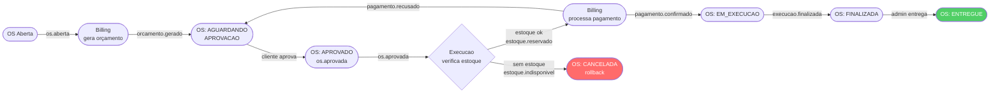
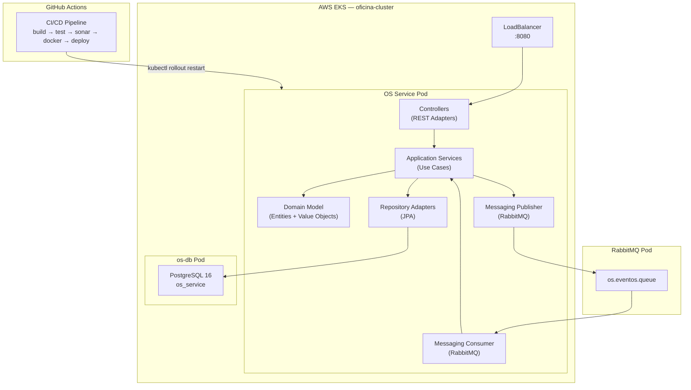
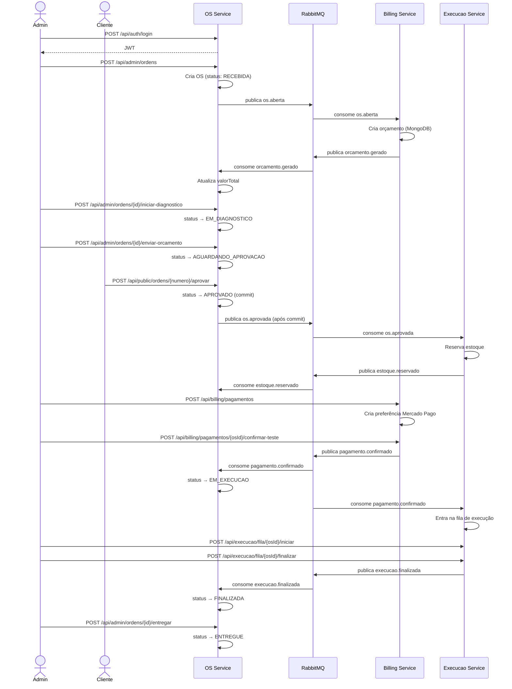
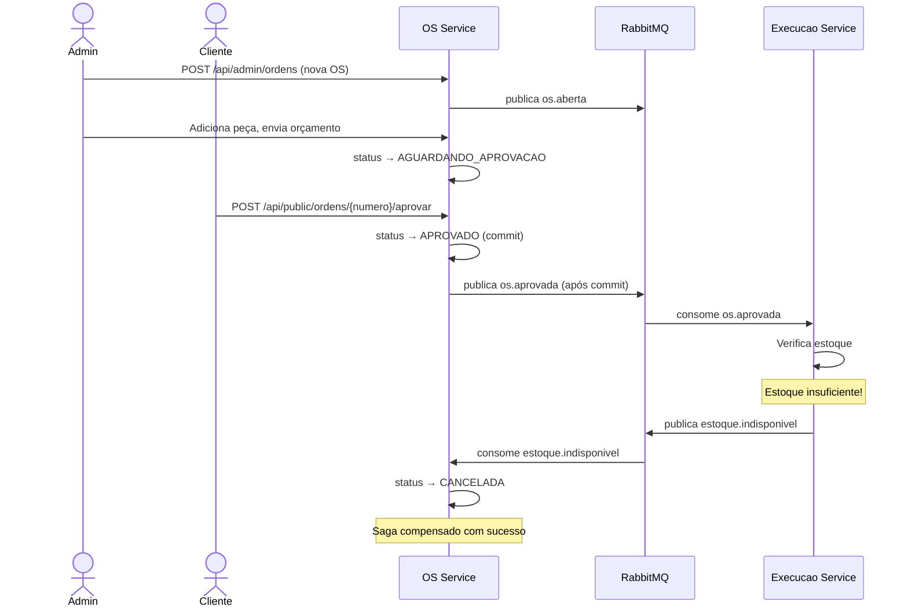
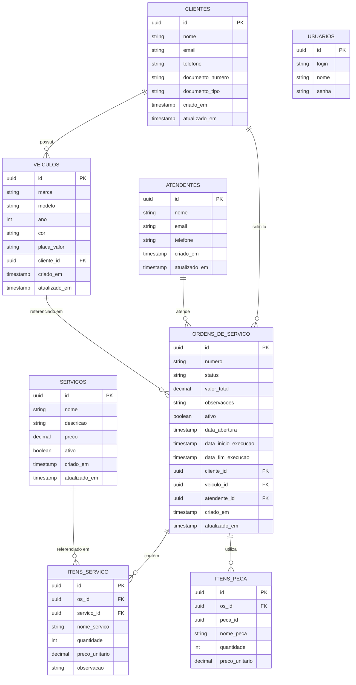
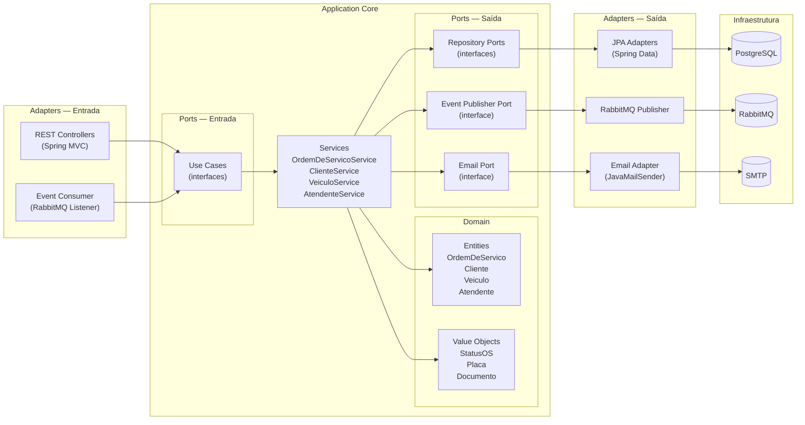

# Documentação de Arquitetura — OS Service
## FIAP Pós-Tech Software Architecture — Tech Challenge Fase 4

---

## Sumário

1. [Visão Geral do Serviço](#1-visão-geral-do-serviço)
2. [Arquitetura da Fase 4 — Microsserviços](#2-arquitetura-da-fase-4--microsserviços)
3. [Diagrama de Componentes do Serviço](#3-diagrama-de-componentes-do-serviço)
4. [Diagrama de Sequência — Saga Happy Path](#4-diagrama-de-sequência--saga-happy-path)
5. [Diagrama de Sequência — Saga Rollback](#5-diagrama-de-sequência--saga-rollback)
6. [Diagrama ER](#6-diagrama-er)
7. [Arquitetura Hexagonal](#7-arquitetura-hexagonal)
8. [Eventos Publicados e Consumidos](#8-eventos-publicados-e-consumidos)
9. [Justificativa do Banco de Dados](#9-justificativa-do-banco-de-dados)
10. [ADRs](#10-adrs)

---

## 1. Visão Geral do Serviço

O **OS Service** é o microsserviço central da plataforma de oficina mecânica. É responsável por gerenciar o ciclo de vida completo das Ordens de Serviço (OS), além de manter o cadastro de clientes, veículos, atendentes e catálogo de serviços.

| Atributo | Valor |
|---|---|
| Linguagem | Java 17 |
| Framework | Spring Boot 3.5.3 |
| Banco de Dados | PostgreSQL 16 |
| Mensageria | RabbitMQ (produtor e consumidor) |
| Porta | 8080 |
| Autenticação | JWT HS384 (admin) |

### Responsabilidades

- Abertura, atualização e consulta de Ordens de Serviço
- Cadastro de clientes, veículos e atendentes
- Catálogo de serviços e relatórios
- Coordenação do Saga Pattern via eventos RabbitMQ
- Endpoint público para aprovação/recusa de OS pelo cliente

---

## 2. Arquitetura da Fase 4 — Microsserviços

Diagrama completo da comunicação entre os 3 microsserviços via RabbitMQ (Exchange: `oficina.events`).

```mermaid
graph TB
    subgraph Cliente["Atores Externos"]
        ADM[Admin / Atendente]
        CLI[Cliente]
    end

    subgraph RMQ["RabbitMQ — oficina.events (Topic Exchange)"]
        direction LR
        E1([os.aberta])
        E2([os.aprovada])
        E3([os.cancelada])
        E4([orcamento.gerado])
        E5([pagamento.confirmado])
        E6([pagamento.recusado])
        E7([estoque.reservado])
        E8([estoque.indisponivel])
        E9([execucao.finalizada])
    end

    subgraph OS["OS Service — :8080\nPostgreSQL"]
        OS_API[REST API]
        OS_CON[Event Consumer]
        OS_PUB[Event Publisher]
    end

    subgraph BILLING["Billing Service — :8082\nMongoDB"]
        B_API[REST API]
        B_CON[Event Consumer]
        B_PUB[Event Publisher]
    end

    subgraph EXEC["Execucao Service — :8081\nPostgreSQL"]
        EX_API[REST API]
        EX_CON[Event Consumer]
        EX_PUB[Event Publisher]
    end

    ADM -->|JWT Bearer| OS_API
    CLI -->|endpoint público| OS_API

    OS_PUB -->|publica| E1
    OS_PUB -->|publica| E2
    OS_PUB -->|publica| E3

    E1 -->|consome| B_CON
    E2 -->|consome| EX_CON
    E3 -->|consome| EX_CON

    B_PUB -->|publica| E4
    B_PUB -->|publica| E5
    B_PUB -->|publica| E6

    E4 -->|consome| OS_CON
    E5 -->|consome| OS_CON
    E5 -->|consome| EX_CON
    E6 -->|consome| OS_CON

    EX_PUB -->|publica| E7
    EX_PUB -->|publica| E8
    EX_PUB -->|publica| E9

    E7 -->|consome| OS_CON
    E8 -->|consome| OS_CON
    E9 -->|consome| OS_CON
```

### Fluxo do Saga Pattern (Coreografado)

---

## 3. Diagrama de Componentes do Serviço

---

## 4. Diagrama de Sequência — Saga Happy Path

---

## 5. Diagrama de Sequência — Saga Rollback

---

## 6. Diagrama ER

---

## 7. Arquitetura Hexagonal

**Regras de dependência:**
- `domain` — zero imports de Spring, JPA ou qualquer framework
- `application/service` — depende apenas de `domain` e interfaces `port`
- `adapter` — implementações concretas, depende de `application`

---

## 8. Eventos Publicados e Consumidos

### Publica

| Routing Key | Trigger | Payload principal |
|---|---|---|
| `os.aberta` | POST /api/admin/ordens | osId, numero, clienteId, itensPeca[] |
| `os.aprovada` | POST /api/public/ordens/{numero}/aprovar (após commit) | osId, numero, pecas[] |
| `os.cancelada` | POST /api/admin/ordens/{id}/cancelar ou recusar | osId, numero |

### Consome

| Routing Key | Origem | Ação |
|---|---|---|
| `orcamento.gerado` | Billing Service | Atualiza valorTotal da OS |
| `estoque.reservado` | Execucao Service | (confirmação — sem mudança de status) |
| `estoque.indisponivel` | Execucao Service | Transiciona OS para CANCELADA |
| `pagamento.confirmado` | Billing Service | Transiciona OS para EM_EXECUCAO |
| `pagamento.recusado` | Billing Service | Transiciona OS para CANCELADA |
| `execucao.finalizada` | Execucao Service | Transiciona OS para FINALIZADA |

---

## 9. Justificativa do Banco de Dados

**PostgreSQL** foi escolhido para o OS Service pelos seguintes motivos:

- O modelo de dados é fortemente relacional: OS → itens → cliente → veículo → atendente
- Necessidade de transações ACID para garantir consistência no ciclo de vida da OS
- Consultas com JOINs entre entidades (relatório de tempo médio, listagem com filtros)
- Migrações gerenciadas pelo Flyway com versionamento controlado

---

## 10. ADRs

### ADR-001: Saga Pattern Coreografado

**Status:** Aceito

**Contexto:** O fluxo de uma OS envolve 3 serviços independentes (OS, Billing, Execucao). É necessário coordenar o fluxo transacional com rollback seguro em caso de falha.

**Decisão:** Implementar o Saga Pattern na variante **coreografada**, onde cada serviço reage a eventos e publica seus próprios resultados, sem orquestrador central.

**Justificativa:**
- Elimina ponto único de falha (sem orquestrador central)
- Cada serviço é autônomo e desacoplado
- Mais resiliente a falhas pontuais
- Alinha com a arquitetura orientada a eventos já adotada

**Consequências:**
- Rastreabilidade do fluxo requer correlação de logs entre serviços
- Necessidade de idempotência nos consumidores

---

### ADR-002: Publicar `os.aprovada` Após Commit da Transação

**Status:** Aceito

**Contexto:** Race condition identificada em produção: o evento `os.aprovada` era publicado **dentro** da transação do método `aprovar()`, antes do commit. O Execucao Service processava o evento e publicava `estoque.indisponivel` antes do commit da transação do OS Service, fazendo com que o status cancelado fosse sobrescrito pelo commit da transação original.

**Decisão:** Registrar o publish do evento no `TransactionSynchronizationManager.afterCommit()`, garantindo que o evento só seja publicado após o commit confirmado.

**Consequências:**
- O Saga é robusto a race conditions de timing
- Em contextos sem transação ativa (testes unitários), o evento é publicado imediatamente como fallback
